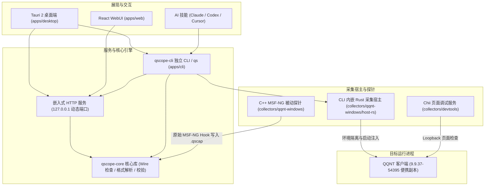

<div align="center">

# QScope

<p align="center">
  <b>QQ (NT 架构) 原生协议观测与分析：Windows x64 与 macOS Apple Silicon</b>
</p>

<p align="center">
  <a href="https://github.com/sj817/QScope/releases"></a>
  
  
  
  
  
</p>

<p align="center">
  📦 开箱即用 &nbsp;·&nbsp; ⚡ 启动即捕获 &nbsp;·&nbsp; 🔬 无损结构解析 &nbsp;·&nbsp; 🧪 便携沙盒隔离 &nbsp;·&nbsp; 🧠 AI 协同
</p>

<p align="center">
  <a href="#下载与安装">下载安装</a> &nbsp;•&nbsp;
  <a href="#开始抓包">开始抓包</a> &nbsp;•&nbsp;
  <a href="#命令行与-qs-工具">命令行工具</a> &nbsp;•&nbsp;
  <a href="#开箱即用的核心体验">核心体验</a> &nbsp;•&nbsp;
  <a href="#架构概览">架构概览</a> &nbsp;•&nbsp;
  <a href="#ai-接入">AI 接入</a> &nbsp;•&nbsp;
  <a href="#当前范围与已知限制">当前限制</a> &nbsp;•&nbsp;
  <a href="#开发">开发</a> &nbsp;•&nbsp;
  <a href="#免责与合规声明">免责声明</a>
</p>

<p align="center">
  <picture>
    <source media="(prefers-color-scheme: dark)" srcset=".github/screenshots/workspace-dark.png">
    
  </picture>
</p>

</div>

---

> [!CAUTION]
> ### 免责与合规声明
> 
> 1. **非官方声明**：“QQ”、“Tencent”等商标及软件著作权均归**腾讯公司**所有。本项目为独立开源技术探索，与腾讯公司无任何关联或官方授权，不分发任何官方二进制文件。
> 2. **法律合规义务**：**不得使用本工具违反**《中华人民共和国网络安全法》、《数据安全法》、《个人信息保护法》、《计算机软件保护条例》及《刑法》（特别是关于计算机安全的第二百八十五条、第二百八十六条）等法律法规；严禁用于任何入侵、攻击、窃取数据、电信诈骗及黑产等违法犯罪行为。
> 3. **金融绝对禁令**：**严禁用于任何涉及资金流转的场景**（包括但不限于抢红包、红包协议逆向、钱包分析、支付转账、充值提现等），内置技能直接拦截并拒绝此类请求。
> 4. **账号风控提示**：接入或调试客户端可能违反《腾讯QQ软件许可及服务协议》，存在**强制下线、功能受限乃至账号封禁**风险。请务必使用测试小号，一切风险由使用者自担。
> 5. **开源免责与下架**：本项目按“现状”（AS-IS）分发，开发者不对任何使用损失承担连带责任。若相关权利人认为涉嫌侵权，请联系维护者进行沟通、整改或下架。

---

## 下载与安装

从 [Releases](https://github.com/sj817/QScope/releases) 下载。每个版本由 `v<版本>` tag 触发 GitHub Actions 构建并签名：

| 发布文件 | 说明与使用方式 |
| :--- | :--- |
| `QScope-<版本>-windows-x64-setup.exe` | **推荐（安装版）**：Windows 11 风格 Inno 安装器，安装桌面端与 CLI，可一键注册全局 `qs` 命令 |
| `QScope-<版本>-windows-x64-portable.zip` | **推荐（便携版）**：解压即用，直接运行 `QScope.exe`，同目录自带 `qscope-cli.exe` 驱动 |
| `QScope-<版本>-windows-x64-cli-webui.zip` | **轻量版（无头 / 终端）**：单文件 `qscope-cli.exe`，包含 CLI 与内嵌 WebUI，适合自动化流水线 |
| `SHA256SUMS.txt` | 用于核对下载文件的 SHA256 完整性哈希 |
| `qscope-update.json` / `.sig` | 在线更新清单及其 Ed25519 签名，由桌面端和 CLI 自动读取 |

> 系统支持 Windows 10 / 11 x64。首次启动需要联网下载约 319 MiB 的受支持官方安装包。桌面端使用 WebView2，安装器在缺少运行时时会自动准备。
> 
> 支持文件关联：在终端或资源管理器执行 `QScope.exe "D:\captures\example.qscap"` 可直接打开查看，已有窗口会自动接收新记录。

### macOS

当前源码可构建 macOS 12 及以上的 Apple Silicon 版 `QScope.app`、DMG 和独立 CLI。Mac 入口支持下载固定版本 QQ 7.0.3（54395），校验官方包后准备独立研究副本，启动双向 MSF 采集与 Chii 页面调试；同时支持 `.qscap`、PB/TLV/JCE 离线分析和本地 WebUI。原生探针、扫码登录前后流量、Chii 的 DOM/样式/控制台及隔离文件目录已在本机研究副本验证。GitHub Release 的现有 Windows 下载和自动更新不适用于 Mac，Intel Mac 暂无打包适配。

在 Mac 上运行 `node tools/build-desktop.ts` 后，安装文件位于 `dist/QScope-<版本>-macos-arm64-<构建标识>/`。双击 DMG，把窗口里的 `QScope.app` 拖到「应用程序」，再从「应用程序」打开；不需要手动解压。也提供 `.app` 和 ZIP。应用使用系统 WKWebView，运行时不需要 Node、开发工具或 WebView2。默认使用 ad-hoc 签名，未做 Apple 公证，下载到其他机器的首次打开可能受到 Gatekeeper 限制；可用 `APPLE_SIGNING_IDENTITY` 指定自己的签名身份，公证需要另行配置。

在「设置 → QQ 抓包」点击「下载并启动 QQ」，首次下载约 465 MiB。QQ 官方 DMG 只读挂载并解包，不执行系统安装；每个 profile 使用独立的研究 `.app`、HOME 和文件目录。默认接收文件目录是该 profile 下的 `files/`，无需全盘访问权限。启动前会校验系统文件写入限制和子进程继承；不满足隔离条件时拒绝启动。仅固定模块身份的已验证采集布局可以启用，其他版本只提供只读扫描。

```bash
"/Applications/QScope.app/Contents/MacOS/qscope-cli" qq inspect --app /Applications/QQ.app
"/Applications/QScope.app/Contents/MacOS/qscope-cli" qq scan --module /path/to/wrapper.node
"/Applications/QScope.app/Contents/MacOS/qscope-cli" cli install
# 若安装结果提示 path_setup_required=true，将 ~/.local/bin 加入自己的 PATH
```

`qq scan` 读取 Mach-O 的 ARM64 切片，通过函数名、日志字符串的独立代码引用及函数边界寻找候选，不按 QQ 版本硬编码 RVA。结果记录模块和切片 SHA256、相对地址、缺失或歧义状态；`hook_ready` 仍为 `false`，调用约定、包体布局和真实采集需独立验证。编译方式或日志字符串变化仍可能使扫描失效，不能据此承诺自动适配所有版本。

`qq inspect` 额外报告版本、签名验证、Hardened Runtime、App Sandbox、动态库加载与调试 entitlement。扫描与检查均不启动 QQ、不修改签名、不申请权限；系统工具无法解释的结果保留为 `unknown` 或 `unverified`。

---

## 开始抓包

以下流程适用于 Windows x64 和 macOS Apple Silicon。

1. **打开程序**：Windows 启动 `QScope.exe`，Mac 打开 `QScope.app`，进入「设置」页面。
2. **下载并启动 QQ**：点击「下载并启动 QQ」。工具会自动拉取官方安装包，核验 SHA256 并免安装解包至私有数据目录，以受限沙盒权限拉起客户端。
3. **手动登录**：在弹出的研究 QQ 窗口中手动扫码登录，随后进行需要观察的操作。
4. **实时分析**：回到 QScope 即可查看双向原始收发包。可随时开始/停止分段录制，或点击「打开 DevTools」唤起内置页面调试器；用完后在「设置 → QQ 抓包」点击「关闭 QQ」。

> **提示**：退出桌面端会一并关闭从界面启动的研究 QQ，抓包文件会写入结束标记；通过 `qs qq start` 或 AI 启动的 QQ 与录制继续运行，再次打开界面会自动重连。
>
> **环境异常**：「设置 → QQ 抓包」的运行环境检查会列出缺失或损坏的组件，可一键修复探针文件和 QQ 解包；安装包本身缺少组件时到「设置 → 更新」下载新版。
>
> **更新**：打开 QScope 时每天最多检查一次 GitHub Release，只提示不自动下载；更新包通过发布签名和 SHA256 校验后，才会保存进行中的录制、关闭研究 QQ，再替换程序并重启。命令行 `qs update --yes` 遇到运行中的任务会拒绝，需要再加 `--close-tasks`。

---

## 命令行与 qs 工具

安装器支持直接注册全局短命令 `qs`。若使用便携版，可在解压目录执行一次命令完成注册：

```powershell
# 将 qs 安装到 %USERPROFILE%\.local\bin\qs.exe，随后打开新终端即可使用
.\qscope-cli.exe cli install

# 卸载全局短命令
.\qscope-cli.exe cli uninstall
```

### 常用命令速查

```powershell
qs web                     # 启动 WebUI 并自动在默认浏览器中打开
qs qq start                # 启动受保护的便携 QQ 研究副本
qs devtools open           # 打开当前可见 QQ 窗口的 DevTools 面板
qs capture sessions        # 列出当前活动的抓包会话
qs capture record start    # 开始切片录制当前会话流量
qs capture record stop     # 停止录制并保存为独立 .qscap 文件
qs qq stop                 # 退出当前活动的研究 QQ
qs doctor                  # 执行环境依赖与状态健康检查
qs decode --hex "08 96 01" # 离线解码 Protobuf 十六进制数据
qs update --check          # 查询 GitHub 上的最新版本
qs update                  # 下载、校验签名并安装新版本
qs update config --proxy http://127.0.0.1:7890  # 设置更新代理（仅 http://）
```

`qscope-cli.exe` 原生支持所有 `qs` 命令。常用高级参数示例：

```powershell
# 自定义抓包目录或端口
qs web --captures "D:\captures"
qs web --port 19850 --no-open

# 使用便携数据目录（直接保存在程序旁的 data/ 文件夹）
qscope-cli.exe --portable web

# 明确指定自定义数据目录或输出 JSON 结果
qs --data-dir "D:\QScope-data" web
qs --json capture sessions
```

> **数据路径说明**：默认数据存储于 `%LOCALAPPDATA%\QScope\`，`--portable` 模式使用程序同级的 `data/`。原始 `.qscap` 文件、账号状态、设置和日志均保存在该目录，SQLite 索引可在需要时通过原包完全重建。

Mac 默认使用 `~/Library/Application Support/QScope/`；通过 `open /path/QScope.app --args --portable` 启动时，数据位于 `.app` 外部同级的 `data/`，不会写入已签名的应用包。Mac 的 `cli install` 安装同一个 CLI 为 `~/.local/bin/qs`，报告当前 PATH 是否可用，不修改 shell 配置文件。

---

## 开箱即用的核心体验

- **启动即被动捕获**：MSF-NG 探针在客户端启动前夕自动就绪，冷启动握手（如 `wtlogin.trans_emp`、密钥协商）、用户扫码登录及后续双向请求与推送全程被动记录，保证现场原始无损。
- **环境隔离沙盒**：写入操作重定向至沙盒专属目录，映射私有 HKCU 注册表，系统常用文件夹重定向，绝不污染本机日常使用的 QQ 聊天记录与个人设置。
- **无 Schema 保真解码**：
  - **Protobuf Wire 剖析**：无需事先编写 `.proto` 文件，真实还原 varint、fixed32/64、LEN、group 字段号与字节结构，保留 64 位大整数精度。
  - **多协议按需切换**：显式切换 TLV16-BE 与 JCE/Tars 视图。
  - **双向联动高亮**：字段树与右侧 Hex 视窗双向同步定位，点击字段即查原始字节范围。
- **多包比对与切片录制**：
  - **差异对比**：支持挑选 2 至 8 个数据包比对字段路径与字节差异，一键开启“只看差异”。
  - **独立切片录制**：在长时全局抓包中随时开始/停止一段局部流量录制（单段上限约 256 MiB / 1 小时），生成独立的 `.qscap` 文件。

<table>
  <tr>
    <td width="50%" valign="top"><p align="center">多包对比：按字段路径对齐，只看差异</p></td>
    <td width="50%" valign="top"><p align="center">完整值查看：字符串里的 JSON 自动识别并高亮</p></td>
  </tr>
  <tr>
    <td width="50%" valign="top"><p align="center">命令筛选：按出现次数只看或排除某个命令</p></td>
    <td width="50%" valign="top"><p align="center">设置：一键下载、校验并启动研究用 QQ</p></td>
  </tr>
</table>

> 截图为真实界面，数据全部由 `apps/web/tests/showcase.mjs` 合成：账号 10001 等均为虚构，字段布局只作演示，不代表已还原的 QQ 协议。构建后台与 WebUI 后运行 `pnpm --dir apps/web run screenshots` 可重新生成。

---

## 架构概览

整体采用上下垂直分层设计，确保展现层、核心解析库与注入采集层解耦清晰：



---

## AI 接入

设置页支持为 **Claude Code**、**Codex** 和 **Cursor** 安装原生技能，可选择当前项目、指定目录或全局安装，也支持卸载及复制通用安装指令：

- **权限自动合并**：Claude Code 安装时会自动将 CLI 绝对路径合并进对应范围的命令白名单中，卸载时会精确清理本次新增权限。
- **闭环协同调试**：AI 助手通过同一个 CLI 进行会话查询、解码、对比与录制，并借助受保护的 Loopback 控制桥查看及操作 QQ 页面，包括可见文本快照、点击、输入、按键和截图（强制校验 PID 与出生 FILETIME，防止误操作其他窗口）。
- **排除后台流量**：`capture events` / `capture wait` 支持 `--hide-heartbeat` 和 `--baseline 秒数`，后者排除动作前已出现的命令，只留下动作带来的新包；`capture noise` 列出安静时段的命令频率。排除只作用于查询，录制保留全部原包。
- **严格合规拦截**：项目严禁任何金融相关任务，内置技能要求直接拒绝红包、转账、钱包等相关指令。

---

## 当前范围与已知限制

| 项目 | 当前状态与说明 |
| :--- | :--- |
| **适配 QQ 版本** | Windows x64 `9.9.37-54395`；macOS Apple Silicon `7.0.3-54395`，由工具自动下载并准备 |
| **macOS 分发** | `.app`、DMG 和 CLI；当前未公证，其他机器的首次打开及不同系统版本仍需独立验证；不支持在线更新 |
| **采集范围** | MSF-NG 协议收发边界及生命周期记录 |
| **HTTP/HTTPS 上传** | 完整采集仍在开发中，当前存在漏采通路 |
| **Windows 中文输入法** | 便携沙盒副本暂时禁用系统 TSF/IME，输入法组合输入暂不可用 |
| **外部已有进程热附加** | 待实现（目前必须由启动器在启动阶段挂载探针） |
| **Schema 编辑与导出** | 待实现（当前为 Wire 级无 Schema 候选解释，不自动生成真实 `.proto`） |

> **安全与隐私提示**：抓包默认保存在数据目录中，文件包含真实的聊天数据、票据等敏感凭据。向外部分享任何 `.qscap` 前请务必先进行脱敏。
> 
> 开发与检查命令见下方「开发」，协作规范见 [AGENTS.md](AGENTS.md)。

---

## 开发

需要 Rust `1.97.0`（由 `rust-toolchain.toml` 固定）、Node `24.22.1` 与 pnpm `9.15.9`。Windows x64 打包另需 MSVC x64 和 Windows SDK；Mac 打包需要 Apple Silicon Mac 和 Xcode Command Line Tools。依赖版本由各 lockfile 固定。

```bash
pnpm install --frozen-lockfile                                         # 根目录：ESLint、Prettier、tools 类型
pnpm --dir apps/web install --frozen-lockfile                          # WebUI
pnpm --dir collectors/devtools install --frozen-lockfile --ignore-scripts  # Chii 页面调试资源
node tools/webui.ts            # 构建并启动开发 WebUI；--fresh 查看首次启动流程
node tools/build-desktop.ts    # 构建本机平台桌面端、CLI 与安装包；--no-bundle 省略安装器/DMG
```

提交前的检查与 CI 一致：

```bash
node tools/check-repo.ts
pnpm run lint && pnpm run format:check && pnpm run typecheck
cargo fmt --all -- --check
cargo clippy --workspace --all-targets --locked -- -D warnings
cargo test --workspace --locked
cargo run -p qscope-web --locked -- types --check
pnpm --dir apps/web run build
cargo build -p qscope-web -p qscope-cli --locked && pnpm --dir apps/web test
```

浏览器测试和截图只使用合成数据。Windows 测试使用 Edge，Mac 测试使用 WebKit；Mac 首次运行测试前用 `pnpm --dir apps/web exec playwright install webkit` 安装 lockfile 对应的浏览器。`QSCOPE_BROWSER` 可显式选择 `webkit` 或 `chromium`。

Mac 打包完成后可运行 `node apps/cli/tests/packaged-macos.ts`，验证 DMG 内的应用和「应用程序」拖拽入口、ZIP 解压后的签名和执行权限，以及中文路径、空 PATH 下的独立 CLI、嵌入资源和合成抓包后台。此检查不启动 QQ，不能替代真实采集验收。

Mac ARM64 原生探针的开发检查为 `node tools/build-native-macos.ts` 和 `node tools/test-native-macos.ts`。前者校验固定版本的 CMake、Dobby 源包并构建有界内存读取与 `.qscap` 写入组件；后者使用合成模块验证插桩、非法指针、截断、结束标记和原函数行为，均不启动 QQ。真实采集仍需单独验证客户端身份、研究副本权限及数据隔离，不能仅凭扫描候选自动启用探针。

Mac 研究副本的 `collectors/qqnt-macos/bootstrap.cjs` 在 QQ 原入口前初始化隔离目录（文件下载默认为 profile 下的 `files/`），并复用现有认证控制桥；由同一个 `qscope-cli` 的原生 worker 提供隔离环境和采集身份。`node --test collectors/qqnt-macos/bootstrap_test.cjs` 使用模拟 Electron API 检查路径、进程身份和入口加载顺序，不启动 QQ。已有 profile 中显式保存的不可访问目录仍需在 QQ「设置 → 存储管理」中改为该 profile 的 `files/`。

发版时先确认 Cargo、Tauri 与各 `package.json` 的版本号一致，再推送 `v<版本>` tag：`.github/workflows/release.yml` 会构建安装器、便携包与 CLI，用 `QSCOPE_RELEASE_SIGNING_KEY` 签名更新清单并发布 Release。手动运行该 workflow 只构建并上传 artifact，不发布。
