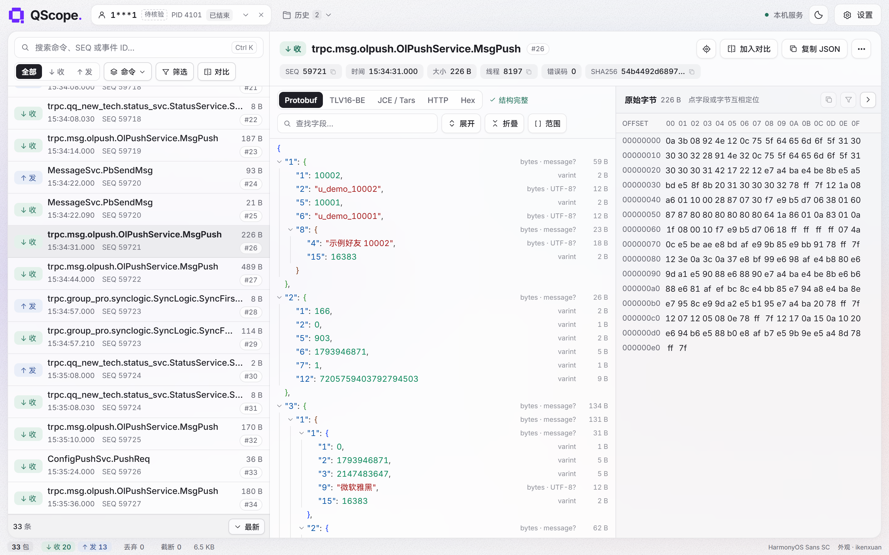
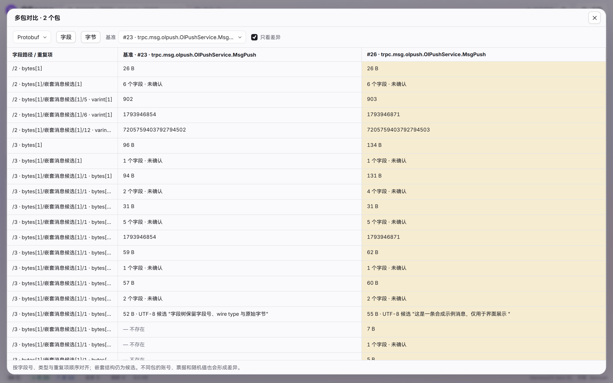
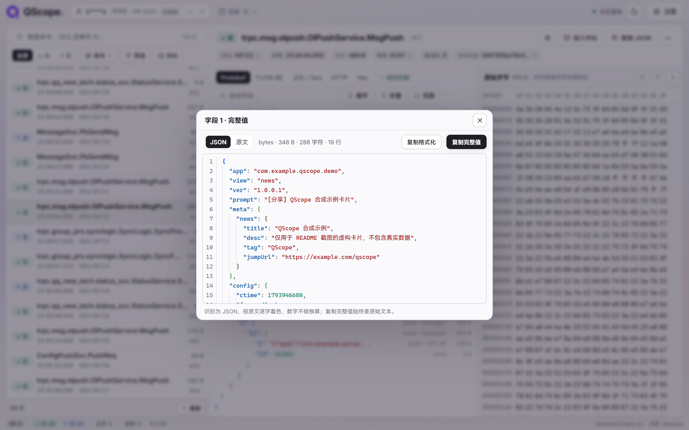
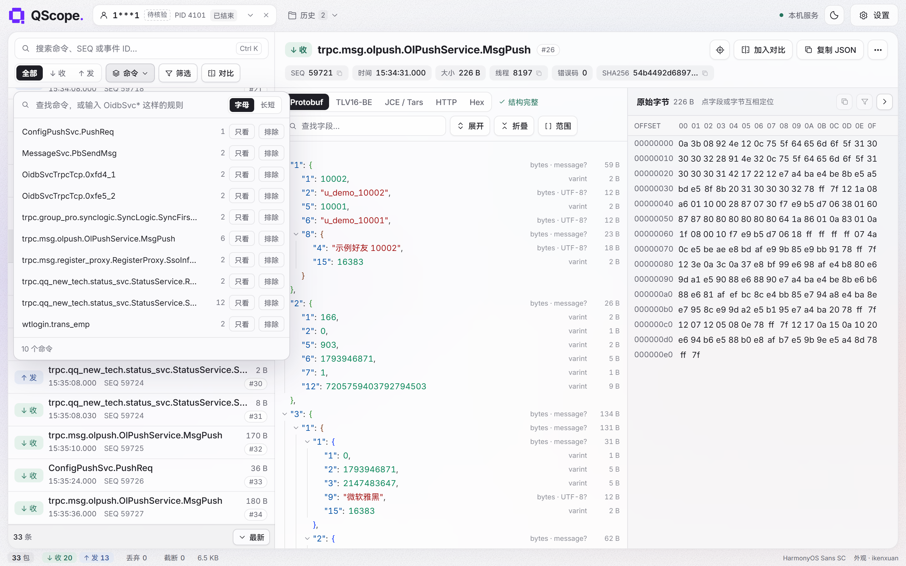
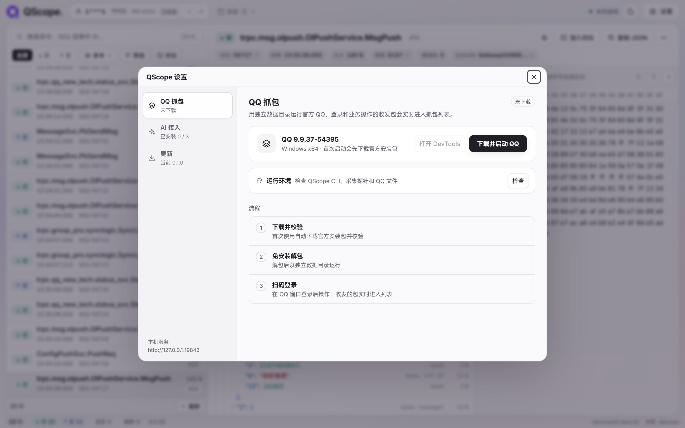
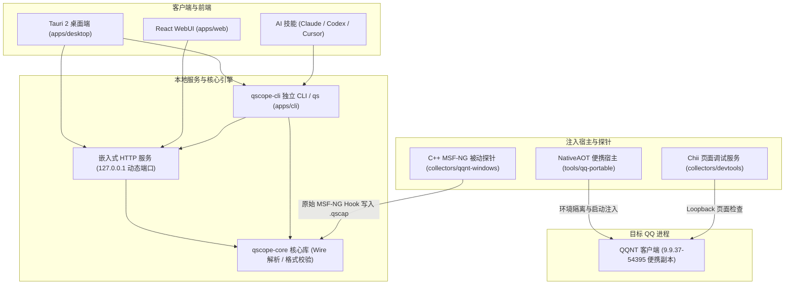

<div align="center">

# QScope

<p align="center">
  <b>面向 Windows x64 QQ (NT 架构) 的原生协议观测与逆向分析工具</b>
</p>

<p align="center">
  <a href="https://github.com/sj817/QScope/releases"></a>
  
  
  
  
  <a href="LICENSE"></a>
</p>

<p align="center">
  📦 开箱即用 &nbsp;·&nbsp; ⚡ 启动即捕获 &nbsp;·&nbsp; 🔬 无损结构解析 &nbsp;·&nbsp; 🧪 便携沙盒隔离 &nbsp;·&nbsp; 🧠 AI 协同
</p>

<p align="center">
  <a href="#下载与安装">下载安装</a> &nbsp;•&nbsp;
  <a href="#快速上手">快速上手</a> &nbsp;•&nbsp;
  <a href="#命令行与-qs-工具">命令行工具</a> &nbsp;•&nbsp;
  <a href="#核心特性">核心特性</a> &nbsp;•&nbsp;
  <a href="#架构概览">架构概览</a> &nbsp;•&nbsp;
  <a href="#ai-接入">AI 接入</a> &nbsp;•&nbsp;
  <a href="#当前限制">当前限制</a> &nbsp;•&nbsp;
  <a href="#开发">开发</a> &nbsp;•&nbsp;
  <a href="#免责与合规声明">免责声明</a>
</p>

<p align="center">
  <picture>
    <source media="(prefers-color-scheme: dark)" srcset=".github/screenshots/workspace-dark.png">
    
  </picture>
</p>

</div>

---

> [!CAUTION]
> ### 免责与合规声明
> 
> 1. **商标与版权归属**：“QQ”及相关图形商标版权均归腾讯公司所有。本项目为独立的网络协议安全研究与技术探索，与腾讯公司无任何官方关联，亦不提供或分发任何官方二进制文件。
> 2. **用途限制与合规**：本工具仅供个人学习、技术研究与防御性安全分析使用。使用者须遵守相关法律法规，严禁将本工具用于任何形式的网络攻击、未授权访问、窃取数据、黑产或侵犯他人合法权益的行为。
> 3. **金融场景硬性禁令**：本项目严格禁止用于任何涉及资金变动与支付结算的场景（包括但不限于抢红包、红包协议分析、钱包、支付转账、充值提现等），自动化扩展与内置技能已默认拦截此类请求。
> 4. **账号风控风险**：使用调试探针或非官方方式接入客户端，可能触发官方安全风控并导致账号受限、强制下线或封号。请务必使用测试账号，由此产生的任何账号与数据损失均由使用者自行承担。
> 5. **开源许可与免责**：本项目代码按“现状”（AS-IS）提供，不包含任何明示或暗示的担保。若相关权利人认为本项目内容涉嫌侵权，请联系维护者进行沟通、整改或下架处理。

---

## 下载与安装

从 [Releases](https://github.com/sj817/QScope/releases) 下载对应构建版本：

| 发布文件 | 说明与用途 |
| :--- | :--- |
| `QScope-<版本>-windows-x64-setup.exe` | **推荐（安装版）**：桌面端 + CLI，安装时可勾选注册全局 `qs` 命令 |
| `QScope-<版本>-windows-x64-portable.zip` | **便携版**：解压即用，双击运行 `QScope.exe`，数据保存在同级目录 |
| `QScope-<版本>-windows-x64-cli-webui.zip` | **轻量版**：单文件 `qscope-cli.exe`，集成命令行与 WebUI，适合无头/自动化环境 |
| `SHA256SUMS.txt` | 文件完整性 SHA256 校验清单 |
| `qscope-update.json` / `.sig` | 在线更新清单及 Ed25519 签名文件 |

> **系统要求**：Windows 10 / 11 x64。首次启动需要联网拉取受支持的官方安装包（约 319 MiB）进行解包隔离准备。桌面端基于 WebView2（缺少运行时系统会提示安装）。
> 
> **文件关联**：直接执行 `QScope.exe "D:\captures\example.qscap"` 可打开历史抓包，已启动的窗口会自动接收并展示记录。

---

## 快速上手

1. **启动程序**：打开 `QScope.exe`，进入「设置」页面。
2. **准备运行环境**：点击「下载并启动 QQ」。程序会自动下载官方受支持版本的安装包并解包至私有沙盒目录，不会影响本机原有的 QQ 数据。
3. **手动登录**：在弹出的研究 QQ 窗口中手动扫码登录，随后进行待分析的操作。
4. **查看与分析**：在 QScope 主界面实时查看双向原始收发包；可随时开始/停止分段录制，或点击「打开 DevTools」调试前端页面；使用完毕后在「设置 → QQ 抓包」点击「关闭 QQ」。

> **退出行为**：关闭桌面端会自动退出由该界面启动的研究 QQ，抓包流会写入结束标记；通过命令行 `qs qq start` 或 AI 启动的后台实例不受影响。
>
> **环境修复**：「设置 → QQ 抓包」提供了运行环境检查，支持一键校验并修复损坏的探针文件或解包数据。

---

## 命令行与 qs 工具

安装器支持直接注册全局 `qs` 命令。如果使用便携版，可在解压目录下手动注册：

```powershell
# 将 qs 安装到 %USERPROFILE%\.local\bin\qs.exe
.\qscope-cli.exe cli install

# 卸载全局短命令
.\qscope-cli.exe cli uninstall
```

### 常用命令速查

```powershell
qs web                     # 启动 WebUI 并在默认浏览器中打开
qs qq start                # 启动隔离的研究 QQ 副本
qs devtools open           # 打开当前可见 QQ 窗口的 DevTools
qs capture sessions        # 查看当前活动的抓包会话
qs capture record start    # 开始录制当前流量切片
qs capture record stop     # 停止录制并保存为独立 .qscap
qs qq stop                 # 退出当前运行的研究 QQ
qs doctor                  # 运行环境依赖与状态检查
qs decode --hex "08 96 01" # 离线解码 Protobuf 十六进制数据
qs update --check          # 检查 GitHub 上的新版本
qs update                  # 下载、校验签名并更新到新版
qs update config --proxy http://127.0.0.1:7890  # 设置更新代理
```

`qscope-cli.exe` 原生支持所有 `qs` 命令。常用进阶参数：

```powershell
# 自定义抓包目录或端口
qs web --captures "D:\captures"
qs web --port 19850 --no-open

# 便携模式（数据保存在程序同级 data/ 目录）
qscope-cli.exe --portable web

# 指定自定义数据目录或以 JSON 输出
qs --data-dir "D:\QScope-data" web
qs --json capture sessions
```

> **数据路径**：默认保存在 `%LOCALAPPDATA%\QScope\`，`--portable` 模式使用程序旁的 `data/`。原始 `.qscap` 文件、设置和日志均保存在此目录，SQLite 数据库为索引缓存，可根据原包随时重建。

---

## 核心特性

- **启动期探针捕获**：基于 MSF-NG 被动探针，在 QQ 进程启动阶段挂载。完整记录从冷启动握手（`wtlogin.trans_emp`、密钥协商）、扫码登录到后续业务收发的双向原始字节流。
- **沙盒运行环境**：文件写入与注册表访问均重定向至独立沙盒目录，完全隔离本机日常使用的 QQ 聊天数据与配置。
- **无 Schema 协议解码**：
  - **Protobuf Wire 解码**：无需事先提供 `.proto`，按字段号、wire type 和原始字节范围还原层级树，保持 64 位大整数精度。
  - **多格式视图**：支持在 Protobuf、TLV16-BE 和 JCE/Tars 视图间切换，字段树与十六进制原始字节双向高亮定位。
- **多包对比与分段录制**：
  - **包差异对齐**：支持挑选 2~8 个数据包按字段路径并排对比，一键过滤相同字段。
  - **切片录制**：长连接持续抓包过程中，可随时截取关键会话并单独另存为 `.qscap` 文件。

<table>
  <tr>
    <td width="50%" valign="top"><p align="center">多包 Diff</p></td>
    <td width="50%" valign="top"><p align="center">完整值查看与 JSON 高亮</p></td>
  </tr>
  <tr>
    <td width="50%" valign="top"><p align="center">按命令过滤流量</p></td>
    <td width="50%" valign="top"><p align="center">环境管理与一键准备</p></td>
  </tr>
</table>

> 截图为真实界面，测试数据由 `apps/web/tests/showcase.mjs` 合成生成，不包含任何真实协议内容。

---

## 架构概览

前后端解耦设计，各层职责边界清晰：



---

## AI 接入

设置页提供了一键为 **Claude Code**、**Codex** 和 **Cursor** 安装原生 Skill 的能力，支持项目级或全局安装：

- **自动化分析**：AI 可直接调用 `qs` CLI 进行会话查询、协议解码、对比和录制，无需人工导出。
- **界面观察与控制**：通过受限的本地 Loopback 控制桥，AI 可以获取 QQ 界面文本快照、模拟点击/按键以及捕获屏幕（通过 PID 与进程启动时间双重校验，防止误操作其他窗口）。
- **流量去噪**：支持 `--hide-heartbeat` 过滤心跳，以及 `--baseline` 过滤动作前已存在的背景命令，方便定位操作触发的新包。
- **金融禁令**：内置 Skill 强制硬编码拦截任何涉及红包、支付、转账等金融相关操作。

---

## 当前限制

| 项目 | 当前状态与说明 |
| :--- | :--- |
| **适配 QQ 版本** | Windows x64 `9.9.37-54395`（程序自动拉取官方包解包） |
| **采集范围** | MSF-NG 协议收发边界及生命周期记录 |
| **HTTP/HTTPS 上传** | 完整采集仍在开发中，当前存在漏采通路 |
| **中文输入法** | 便携沙盒副本暂时禁用系统 TSF/IME，输入法组合输入暂不可用 |
| **外部已有进程热附加** | 暂不支持（探针必须在进程启动阶段注入） |
| **Schema 编辑与导出** | 暂未实现（当前仅提供 Wire 级无 Schema 解释，不自动生成真实 `.proto`） |

> **安全与隐私提示**：抓包默认保存在数据目录中，文件包含真实的聊天数据、票据等敏感凭据。向外部分享任何 `.qscap` 前请务必先进行脱敏。

---

## 开发

开发环境需要 Windows x64、Rust `1.97.0`（通过 `rust-toolchain.toml` 固定）、Node `24.22.1` 与 pnpm `9.15.9`；构建打包另需 MSVC x64 与 Windows SDK。

```bash
pnpm install --frozen-lockfile                                         # 根目录：ESLint、Prettier、tools 类型
pnpm --dir apps/web install --frozen-lockfile                          # WebUI
pnpm --dir collectors/devtools install --frozen-lockfile --ignore-scripts  # Chii 页面调试资源
node tools/webui.ts            # 构建并启动开发 WebUI；--fresh 查看首次启动流程
node tools/build-desktop.ts    # 构建桌面端、CLI、便携包与安装器
```

提交代码前的检查命令：

```bash
node tools/check-repo.ts
pnpm run lint && pnpm run format:check && pnpm run typecheck
cargo fmt --all -- --check
cargo clippy --workspace --all-targets --locked -- -D warnings
cargo test --workspace --locked
cargo run -p qscope-web --locked -- types --check
pnpm --dir apps/web run build
cargo build -p qscope-web -p qscope-cli --locked && pnpm --dir apps/web test
```

浏览器测试和截图只使用合成数据。发版通过推送 `v<版本>` tag 触发 GitHub Actions 自动构建、签名并发布 Release。
