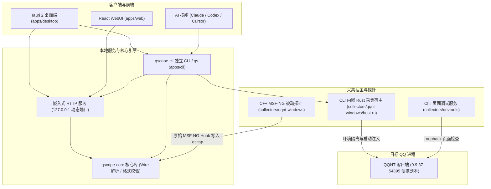

<div align="center">

# QScope

<p align="center">
  <b>QQ (NT 架构) 原生协议观测与分析：Windows x64 与 macOS Apple Silicon</b>
</p>

<p align="center">
  <a href="https://github.com/sj817/QScope/releases"></a>
  
  
  
  
  <a href="LICENSE"></a>
</p>

<p align="center">
  📦 开箱即用 &nbsp;·&nbsp; ⚡ 启动即捕获 &nbsp;·&nbsp; 🔬 无损结构解析 &nbsp;·&nbsp; 🧪 便携沙盒隔离 &nbsp;·&nbsp; 🧠 AI 协同
</p>

<p align="center">
  <a href="#下载与安装">下载安装</a> &nbsp;•&nbsp;
  <a href="#快速上手">快速上手</a> &nbsp;•&nbsp;
  <a href="#命令行与-qs-工具">命令行工具</a> &nbsp;•&nbsp;
  <a href="#核心特性">核心特性</a> &nbsp;•&nbsp;
  <a href="#架构概览">架构概览</a> &nbsp;•&nbsp;
  <a href="#ai-接入">AI 接入</a> &nbsp;•&nbsp;
  <a href="#当前限制">当前限制</a> &nbsp;•&nbsp;
  <a href="#开发">开发</a> &nbsp;•&nbsp;
  <a href="#免责与合规声明">免责声明</a>
</p>

<p align="center">
  <picture>
    <source media="(prefers-color-scheme: dark)" srcset=".github/screenshots/workspace-dark.png">
    
  </picture>
</p>

</div>

---

> [!CAUTION]
> ### 免责与合规声明
> 
> 1. **商标与版权归属**：“QQ”及相关图形商标版权均归腾讯公司所有。本项目为独立的网络协议安全研究与技术探索，与腾讯公司无任何官方关联，亦不提供或分发任何官方二进制文件。
> 2. **用途限制与合规**：本工具仅供个人学习、技术研究与防御性安全分析使用。使用者须遵守相关法律法规，严禁将本工具用于任何形式的网络攻击、未授权访问、窃取数据、黑产或侵犯他人合法权益的行为。
> 3. **金融场景硬性禁令**：本项目严格禁止用于任何涉及资金变动与支付结算的场景（包括但不限于抢红包、红包协议分析、钱包、支付转账、充值提现等），自动化扩展与内置技能已默认拦截此类请求。
> 4. **账号风控风险**：使用调试探针或非官方方式接入客户端，可能触发官方安全风控并导致账号受限、强制下线或封号。请务必使用测试账号，由此产生的任何账号与数据损失均由使用者自行承担。
> 5. **开源许可与免责**：本项目代码按“现状”（AS-IS）提供，不包含任何明示或暗示的担保。若相关权利人认为本项目内容涉嫌侵权，请联系维护者进行沟通、整改或下架处理。

---

## 下载与安装

从 [Releases](https://github.com/sj817/QScope/releases) 下载对应构建版本：

| 发布文件 | 说明与用途 |
| :--- | :--- |
| `QScope-windows-x64-setup.exe` | **推荐（安装版）**：桌面端 + CLI，安装时可勾选注册全局 `qs` 命令 |
| `QScope-windows-x64.zip` | **便携版**：解压即用，双击运行 `QScope.exe`，数据保存在同级目录 |
| `QScope-windows-x64-cli-webui.zip` | **轻量版**：单文件 `qscope-cli.exe`，集成命令行与 WebUI，适合无头/自动化环境 |
| `QScope-macos-arm64.dmg` | **Mac 安装版**：双击后把 `QScope.app` 拖到「应用程序」 |
| `QScope-macos-arm64.zip` | 完整 Mac 应用包，也是 App 在线更新使用的归档 |
| `QScope-macos-arm64-cli-webui.zip` | Mac 独立 CLI，内嵌 WebUI 与采集组件 |
| `SHA256SUMS.txt` | 文件完整性 SHA256 校验清单 |
| `qscope-update.json` / `.sig` | 在线更新清单及 Ed25519 签名文件 |
| `qscope-update-macos-arm64.json` / `.sig` | Mac 专用在线更新清单及 Ed25519 签名文件 |

> **系统要求**：Windows 10 / 11 x64。首次启动需要联网拉取受支持的官方安装包（约 319 MiB）进行解包隔离准备。桌面端基于 WebView2（缺少运行时系统会提示安装）。
> 
> **文件关联**：直接执行 `QScope.exe "D:\captures\example.qscap"` 可打开历史抓包，已启动的窗口会自动接收并展示记录。

### macOS

当前源码可构建 macOS 12 及以上的 Apple Silicon 版 `QScope.app`、DMG 和独立 CLI。Mac 入口支持下载固定版本 QQ 7.0.3（54395），校验官方包后准备独立研究副本，启动双向 MSF 采集与 Chii 页面调试；同时支持 `.qscap`、PB/TLV/JCE 离线分析和本地 WebUI。原生探针、扫码登录前后流量、Chii 的 DOM/样式/控制台及隔离文件目录已在本机研究副本验证。Intel Mac 暂无打包适配。现有 `v0.1.1` Release 仍只有 Windows 资产；Mac 更新服务需要下一次发布包含 Mac 安装包和独立签名清单的版本。

在 Mac 上运行 `pnpm build` 后，安装文件位于 `dist/QScope-<版本>-macos-arm64-<构建标识>/`。双击 DMG，把窗口里的 `QScope.app` 拖到「应用程序」，再从「应用程序」打开；不需要手动解压。也提供 `.app` 和 ZIP。应用使用系统 WKWebView，运行时不需要 Node、开发工具或 WebView2。默认使用 ad-hoc 签名，未做 Apple 公证，下载到其他机器的首次打开可能受到 Gatekeeper 限制；可用 `APPLE_SIGNING_IDENTITY` 指定自己的签名身份，公证需要另行配置。

在「设置 → QQ 抓包」点击「下载并启动 QQ」，首次下载约 465 MiB。QQ 官方 DMG 只读挂载并解包，不执行系统安装；每个 profile 使用独立的研究 `.app`、HOME 和文件目录。默认接收文件目录是该 profile 下的 `files/`，无需全盘访问权限。启动前会校验系统文件写入限制和子进程继承；不满足隔离条件时拒绝启动。仅固定模块身份的已验证采集布局可以启用，其他版本只提供只读扫描。

Mac 应用与独立 CLI 均支持在线更新。更新器读取 Mac 专用签名清单，校验包的 SHA256、架构、版本、应用身份及代码签名，保留执行权限与包内符号链接。App 下载校验完成后点击「重启完成更新」，才会保存录制、关闭研究 QQ、整体替换应用并重新打开；替换失败会恢复原版，成功时保留同级完整备份。账号和抓包仍保存在应用包外的数据目录中。安装目录不可写时会在关闭任务前报错，需手动安装 DMG。

```bash
"/Applications/QScope.app/Contents/MacOS/qscope-cli" qq inspect --app /Applications/QQ.app
"/Applications/QScope.app/Contents/MacOS/qscope-cli" qq scan --module /path/to/wrapper.node
"/Applications/QScope.app/Contents/MacOS/qscope-cli" cli install
# 若安装结果提示 path_setup_required=true，将 ~/.local/bin 加入自己的 PATH
```

`qq scan` 读取 Mach-O 的 ARM64 切片，通过函数名、日志字符串的独立代码引用及函数边界寻找候选，不按 QQ 版本硬编码 RVA。结果记录模块和切片 SHA256、相对地址、缺失或歧义状态；`hook_ready` 仍为 `false`，调用约定、包体布局和真实采集需独立验证。编译方式或日志字符串变化仍可能使扫描失效，不能据此承诺自动适配所有版本。

Windows 同样支持 `qs qq scan --module <wrapper.node>`，可在任意开发平台只读检查 PE x64 模块。扫描结合函数名、日志字符串的 RIP 相对引用及 PE 异常表定位函数边界，分别记录候选、缺失和歧义。Windows 采集器在启动前重新定位入口，并核验模块 SHA256 和已验证函数前缀，随后将本次地址传入探针。

`qq inspect` 额外报告版本、签名验证、Hardened Runtime、App Sandbox、动态库加载与调试 entitlement。扫描与检查均不启动 QQ、不修改签名、不申请权限；系统工具无法解释的结果保留为 `unknown` 或 `unverified`。

---

## 快速上手

以下流程适用于 Windows x64 和 macOS Apple Silicon。

1. **打开程序**：Windows 启动 `QScope.exe`，Mac 打开 `QScope.app`，进入「设置」页面。
2. **下载并启动 QQ**：点击「下载并启动 QQ」。工具会自动拉取官方安装包，核验 SHA256 并免安装解包至私有数据目录，以受限沙盒权限拉起客户端。
3. **手动登录**：在弹出的研究 QQ 窗口中手动扫码登录，随后进行需要观察的操作。
4. **实时分析**：回到 QScope 即可查看双向原始收发包。可随时开始/停止分段录制，或点击「打开 DevTools」唤起内置页面调试器；用完后在「设置 → QQ 抓包」点击「关闭 QQ」。

> **退出行为**：关闭桌面端会自动退出由该界面启动的研究 QQ，抓包流会写入结束标记；通过命令行 `qs qq start` 或 AI 启动的后台实例不受影响。
>
> **环境修复**：「设置 → QQ 抓包」提供了运行环境检查，支持一键校验并修复损坏的探针文件或解包数据。

---

## 命令行与 qs 工具

安装器支持直接注册全局 `qs` 命令。如果使用便携版，可在解压目录下手动注册：

```powershell
# 将 qs 安装到 %USERPROFILE%\.local\bin\qs.exe
.\qscope-cli.exe cli install

# 卸载全局短命令
.\qscope-cli.exe cli uninstall
```

### 常用命令速查

```powershell
qs web                     # 启动 WebUI 并在默认浏览器中打开
qs qq start                # 启动隔离的研究 QQ 副本
qs devtools open           # 打开当前可见 QQ 窗口的 DevTools
qs capture sessions        # 查看当前活动的抓包会话
qs capture record start    # 开始录制当前流量切片
qs capture record stop     # 停止录制并保存为独立 .qscap
qs qq stop                 # 退出当前运行的研究 QQ
qs doctor                  # 运行环境依赖与状态检查
qs decode --hex "08 96 01" # 离线解码 Protobuf 十六进制数据
qs update --check          # 检查 GitHub 上的新版本
qs update                  # 下载、校验签名并更新到新版
qs update config --proxy http://127.0.0.1:7890  # 设置更新代理
```

`qscope-cli.exe` 原生支持所有 `qs` 命令。常用进阶参数：

```powershell
# 自定义抓包目录或端口
qs web --captures "D:\captures"
qs web --port 19850 --no-open

# 便携模式（数据保存在程序同级 data/ 目录）
qscope-cli.exe --portable web

# 指定自定义数据目录或以 JSON 输出
qs --data-dir "D:\QScope-data" web
qs --json capture sessions
```

> **数据路径**：默认保存在 `%LOCALAPPDATA%\QScope\`，`--portable` 模式使用程序旁的 `data/`。原始 `.qscap` 文件、设置和日志均保存在此目录，SQLite 数据库为索引缓存，可根据原包随时重建。

Mac 默认使用 `~/Library/Application Support/QScope/`；通过 `open /path/QScope.app --args --portable` 启动时，数据位于 `.app` 外部同级的 `data/`，不会写入已签名的应用包。Mac 的 `cli install` 安装同一个 CLI 为 `~/.local/bin/qs`，报告当前 PATH 是否可用，不修改 shell 配置文件。

---

## 核心特性

- **启动期探针捕获**：基于 MSF-NG 被动探针，在 QQ 进程启动阶段挂载。完整记录从冷启动握手（`wtlogin.trans_emp`、密钥协商）、扫码登录到后续业务收发的双向原始字节流。
- **沙盒运行环境**：文件写入与注册表访问均重定向至独立沙盒目录，完全隔离本机日常使用的 QQ 聊天数据与配置。
- **无 Schema 协议解码**：
  - **Protobuf Wire 解码**：无需事先提供 `.proto`，按字段号、wire type 和原始字节范围还原层级树，保持 64 位大整数精度。
  - **多格式视图**：支持在 Protobuf、TLV16-BE 和 JCE/Tars 视图间切换，字段树与十六进制原始字节双向高亮定位。
- **多包对比与分段录制**：
  - **包差异对齐**：支持挑选 2~8 个数据包按字段路径并排对比，一键过滤相同字段。
  - **切片录制**：长连接持续抓包过程中，可随时截取关键会话并单独另存为 `.qscap` 文件。

<table>
  <tr>
    <td width="50%" valign="top"><p align="center">多包 Diff</p></td>
    <td width="50%" valign="top"><p align="center">完整值查看与 JSON 高亮</p></td>
  </tr>
  <tr>
    <td width="50%" valign="top"><p align="center">按命令过滤流量</p></td>
    <td width="50%" valign="top"><p align="center">环境管理与一键准备</p></td>
  </tr>
</table>

> 截图为真实界面，测试数据由 `tests/web/showcase.mjs` 合成生成，不包含任何真实协议内容。

---

## 架构概览

前后端解耦设计，各层职责边界清晰：



---

## AI 接入

设置页提供了一键为 **Claude Code**、**Codex** 和 **Cursor** 安装原生 Skill 的能力，支持项目级或全局安装：

- **自动化分析**：AI 可直接调用 `qs` CLI 进行会话查询、协议解码、对比和录制，无需人工导出。
- **界面观察与控制**：通过受限的本地 Loopback 控制桥，AI 可以获取 QQ 界面文本快照、模拟点击/按键以及捕获屏幕（通过 PID 与进程启动时间双重校验，防止误操作其他窗口）。
- **流量去噪**：支持 `--hide-heartbeat` 过滤心跳，以及 `--baseline` 过滤动作前已存在的背景命令，方便定位操作触发的新包。
- 技能自带独立版本号，设置页及 `qs agent status` 会核对模板和已安装内容的 SHA256。升级后显示可更新，保留对旧安装的识别与手工修改的冲突检查。
- **金融禁令**：内置 Skill 强制硬编码拦截任何涉及红包、支付、转账等金融相关操作。

---

## 当前限制

| 项目 | 当前状态与说明 |
| :--- | :--- |
| **适配 QQ 版本** | Windows x64 `9.9.37-54395`；macOS Apple Silicon `7.0.3-54395`，由工具自动下载并准备 |
| **macOS 分发** | `.app`、DMG 和 CLI；App/CLI 使用独立签名更新清单；当前未公证，其他机器的首次打开及不同系统版本仍需独立验证 |
| **采集范围** | MSF-NG 协议收发边界及生命周期记录 |
| **HTTP/HTTPS 上传** | 完整采集仍在开发中，当前存在漏采通路 |
| **Windows 中文输入法** | 便携沙盒副本暂时禁用系统 TSF/IME，输入法组合输入暂不可用 |
| **外部已有进程热附加** | 待实现（目前必须由启动器在启动阶段挂载探针） |
| **Schema 编辑与导出** | 待实现（当前为 Wire 级无 Schema 候选解释，不自动生成真实 `.proto`） |

> **安全与隐私提示**：抓包默认保存在数据目录中，文件包含真实的聊天数据、票据等敏感凭据。向外部分享任何 `.qscap` 前请务必先进行脱敏。

---

## 开发

使用 Node `24.22.1`、pnpm `9.15.9` 和 Rust `1.97.0`。Rust 由 `rust-toolchain.toml` 固定，pnpm 由根 `packageManager` 固定。可以通过 Corepack 安装项目指定的 pnpm，也可以执行 `npm install --global pnpm@9.15.9`。Windows 采集器需要 MSVC x64 和 Windows SDK，Mac 采集器需要 Apple Silicon Mac 与 Xcode Command Line Tools。

### 从新克隆开始

在仓库根目录执行一次安装，再启动开发服务。

```bash
pnpm install
pnpm dev
```

本地开发直接使用 `pnpm install`，修改依赖时同步更新根锁文件。CI 显式使用 `pnpm install --frozen-lockfile` 校验依赖声明与锁文件的一致性。

`pnpm dev` 自动构建本机采集器、WebUI 和 Rust 后台，开发页面位于 `http://127.0.0.1:19840/`，数据保存到 `.tmp/dev/`。`pnpm dev --fresh` 使用独立空目录预览首次启动，`pnpm dev --fresh --reset` 清除该预览的数据后重建。需要前端热更新时，在另一终端运行 `pnpm dev:frontend`，打开 Vite 输出的本机地址，API 转发到开发后台。

首次原生构建自动下载公开依赖并校验固定 SHA256，缓存位于 `.cache/dependencies/`。Windows 的 MinHook 直接使用固定提交的公开源码文件，Mac 的 CMake、Dobby 与 Windows 安装器组件使用已登记版本的公开归档。新克隆可重新生成所有构建输入，`artifacts/` 用于本机研究证据。普通构建的入口为 `pnpm build`。

### 目录约定

| 目录 | 内容 |
| --- | --- |
| `apps/` | CLI、桌面壳、WebUI 和本地会话服务 |
| `crates/` | 共享 Rust 解码、存储及自动化逻辑 |
| `collectors/` | 平台采集器源码、客户端身份和公开原生依赖声明 |
| `scripts/` | TypeScript 构建、开发、契约及发布编排 |
| `tests/` | CLI 集成测试、浏览器测试、原生测试及验收脚本 |
| `.cache/` | 可重建的公共工具链依赖缓存，Git 忽略 |
| `build/`、`target/`、`dist/` | 可重建产物，Git 忽略 |
| `.tmp/` | 开发数据和临时验证文件，Git 忽略 |

Node 工程属于同一个 pnpm 工作区，共用根锁文件。测试工程显式声明 Playwright、TypeScript 和 Node 类型依赖，根 ESLint 和类型检查覆盖维护脚本、测试及 WebUI 配置。Rust 内联单元测试留在所属模块，外部测试统一归到 `tests/`。

### 常用命令

| 命令 | 用途 |
| --- | --- |
| `pnpm dev` | 构建并启动本机开发 WebUI |
| `pnpm dev:frontend` | 连接开发后台的 Vite 热更新 |
| `pnpm build` | 本机 Windows 或 Mac 的桌面、CLI 及安装包 |
| `pnpm build --no-bundle` | 桌面及 CLI，省略安装器或 DMG |
| `pnpm build:cli` | 内嵌 WebUI 的独立 CLI 归档，支持 Windows、Mac 和 Linux |
| `pnpm build:webui` | 仅构建 WebUI |
| `pnpm build:native` | 构建本机采集器，按平台选择实现 |
| `pnpm generate:contract` | 从 Rust 响应类型重新生成前端契约 |
| `pnpm check` | 布局、ESLint、格式、类型、Rust 规范和契约检查 |
| `pnpm test` | 脚本及 Rust 工作区测试 |
| `pnpm test:webui` | 构建后台、WebUI 并运行浏览器合成验收 |
| `pnpm test:native` | 验证已构建采集器的合成数据 |
| `pnpm test:packaged` | 验证本机已构建分发包 |
| `pnpm test:packaged --cli-only` | 验证 `pnpm build:cli` 的独立归档、执行权限与内嵌资源 |
| `pnpm test:update` | 验证 Mac 更新归档、签名、权限及回滚备份 |
| `pnpm screenshots` | 用合成抓包生成 README 截图 |

Windows 浏览器测试默认使用 Edge，Mac 默认使用 WebKit，Linux 默认使用 Chromium。首次准备 Mac 或 Linux 浏览器时执行对应命令。

```bash
pnpm --filter @qscope/tests exec playwright install webkit
pnpm --filter @qscope/tests exec playwright install --with-deps chromium
```

`QSCOPE_BROWSER` 可选择 `webkit` 或 `chromium`，`QSCOPE_BROWSER_CHANNEL` 可指定浏览器通道。浏览器与打包验收使用合成数据，真实 QQ 登录、数据隔离及多端安装分别验收。

Mac 的 `collectors/qqnt-macos/bootstrap.cjs` 在原入口前初始化隔离目录，复用认证控制桥，同一个 CLI 原生 worker 维护采集身份。已有 profile 中保存的不可访问下载目录，需要在 QQ「设置 → 存储管理」改为该 profile 的 `files/`。

### CI 与发布

仓库检查覆盖 Windows、macOS 和 Linux。公共准备步骤复用本机工作区配置，使用 pnpm 与 Rust 的现成 Actions 管理工具链和缓存。平台打包流程供主分支检查及发布共用。CI 标题使用小写英文，步骤名称和说明使用中文。

发版前统一 Cargo、Tauri 和产品 `package.json` 的版本号，推送 `v<版本>` 标签触发发布。Windows 与 Mac 在独立作业构建并验收，聚合作业校验全部分发包后独占 `QSCOPE_RELEASE_SIGNING_KEY`，签署两个平台的更新清单，再由 `softprops/action-gh-release` 发布完整 Release。手动运行发布流程保存签名产物供下载，Mac 的 Apple 签名及公证另由对应凭据配置。
